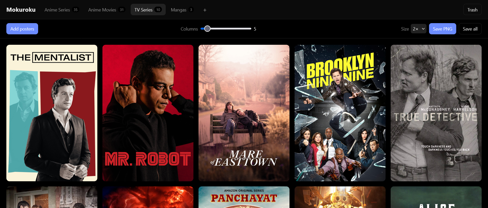

# Mokuroku

Mokuroku is a local-only poster shelf: collect poster images into categories, arrange them in a grid, and save each grid as a PNG.

## Run

1. Install [Node.js](https://nodejs.org) 18 or later. Nothing else is needed.
2. Clone this repository.
3. Start the app:
   - **Windows:** double-click `start.bat`. It starts the server and opens the app in your browser.
   - **Any system:** open a terminal in this folder, run `node server.js`, then open <http://127.0.0.1:9153>.
4. Keep the server window open while you use the app. Close it, or press Ctrl+C, to stop.

Posters are stored in the `posters/` folder, one subfolder per category. Saved PNGs go to `exports/`. They are created the first time you use the app.

## Use

- **Add posters:** drop images from your computer or a website, paste with Ctrl+V, or click "Add posters".
- **Replace a poster:** drop or paste a better image onto it.
- **Organise:** drag posters to reorder them, or onto another tab to move them. Right-click for more options.
- **Categories:** "+" adds one; double-click a tab to rename it.
- **Export:** "Save PNG" saves the open category to `exports/`, at 1x or 2x; "Save all" saves every category.
- **Trash:** removed posters and categories can be restored from the Trash panel.
